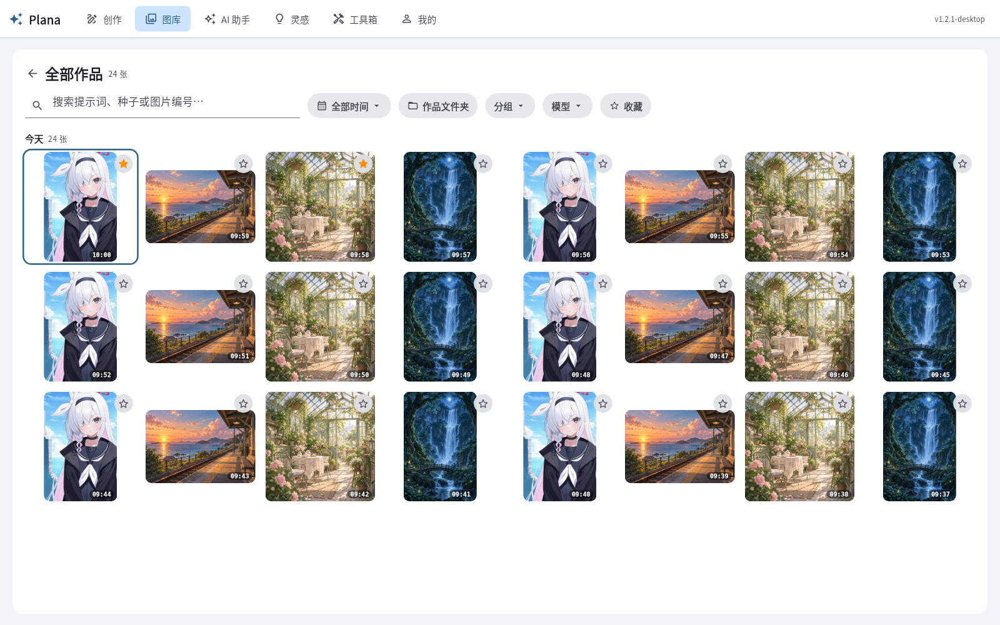

# Plana App Desktop

**面向 Windows 与 macOS 的 AI 绘图工作台**

编辑提示词、生成图片、整理作品，与 AI 助手一起创作。

[开始使用](#开始使用) · [下载与安装](#下载与安装) · [主要功能](#主要功能) · [更新与数据](#更新与数据) · [问题反馈](https://github.com/shenghuo2/Plana-App-Desktop/issues)

Plana App Desktop 将 [Plana App](https://github.com/mc5024/Plana-App) 的绘图与作品管理功能带到桌面，基于 [Windows 重构版](https://github.com/LingXia979/Plana-App-for-windows/tree/Plana-app-for-windows) 继续适配 Windows 和 macOS。

绘图需要自行配置可用的 NovelAI 账号、兼容中转接口或 Bot 接入。AI 助手也支持自定义模型接口。安装包不附带账号或 API Key。

## 开始使用

1. **配置接入**：打开「我的 → 账号与接入」。直连用户在「管理令牌」中添加 NovelAI Token 或第三方接口的 URL + Key，并选为主账号；使用 Bot 的用户在同页配置授权。
2. **生成第一张图**：回到「创作」，选择模型，在正向提示词中输入 `1girl, solo, white dress, blue sky, soft lighting`，调整尺寸后点击生成。结果显示在画布中，并保存到当前图库。
3. **继续创作**：在右侧 AI 助手中整理想法和提示词，或拖入图片用作图生图、Vibe、角色参考。进入「图库」可收藏、筛选和批量整理作品。

创作页把提示词、画布与助手放在同一个窗口，两侧栏的宽度可以拖动调整。

## 下载与安装

当前公开预发布为 **1.2.1-desktop（构建 70）**。从 [发布页](https://github.com/shenghuo2/Plana-App-Desktop/releases/tag/v1.2.1-desktop) 下载，无需登录 GitHub。

| 平台 | 安装包 | 选择建议 |
|---|---|---|
| Windows x64 | [安装程序 EXE](https://github.com/shenghuo2/Plana-App-Desktop/releases/download/v1.2.1-desktop/Plana-App-Desktop-Windows-1.2.1-desktop-x64-setup.exe) · [便携 ZIP](https://github.com/shenghuo2/Plana-App-Desktop/releases/download/v1.2.1-desktop/Plana-App-Desktop-Windows-1.2.1-desktop-x64.zip) | 安装版带中文向导与开始菜单入口；ZIP 适合便携使用 |
| macOS 14+ · Apple Silicon | [标准版 DMG](https://github.com/shenghuo2/Plana-App-Desktop/releases/download/v1.2.1-desktop/Plana-App-Desktop-macOS-arm64.dmg) | 日常绘图与本地作品管理 |

**Windows**：运行 `-setup.exe`，按中文向导选择可写入的安装目录，可选桌面快捷方式；默认安装到当前用户目录，无需管理员权限。使用便携版时，完整解压 ZIP 后运行 `plana_app_for_windows.exe`，移动时连同 `output` 作品文件夹一起移动。两种包均附带所需运行库。

**macOS**：退出旧应用，打开 DMG，将 `Plana App Desktop.app` 拖入「应用程序」后运行。目前提供 ARM64 包，适用于 Apple Silicon Mac。

发布页提供安装包的 SHA-256 校验值，后续版本统一使用 `SHA256SUMS.txt`。Windows 包未做代码签名；macOS 包使用 ad-hoc 签名，尚未经过 Apple 公证。

## 主要功能

| 你要做的事 | 桌面版提供的操作 |
|---|---|
| 编辑与切换提示词 | 多画布、正负提示词分区、标签／文本视图、预设切换；提示词卡片可折叠，也可打开大屏编辑 |
| 使用图片参考 | 文件多选、拖入、剪贴板粘贴；图生图、Vibe、角色参考与图片元数据导入 |
| 放大或重绘图片 | 独立的图生图放大与 2× 超分辨率入口；导入窗口也可对外部图片执行超分 |
| 借助 AI 整理想法 | 独立对话页与创作侧栏，多图附件、会话管理、消息编辑、提示词提案和生成图查看 |
| 管理生成任务 | 多账号参与生成、并发队列与循环生成；右上角查看运行中的任务状态 |
| 整理作品 | 图库、搜索、日期／模型筛选、收藏、多选、批量导出，以及「移动到」「复制到」其他图库 |
| 浏览大图 | 缩放、拖动、左右翻图，查看种子与提示词；复制图片到其他应用，按 Esc 或点击外侧空白关闭 |
| 积累创作素材 | 灵感库、法典、分类与标签搜索；角色、画风和场景可导入创作页 |
| 调整桌面布局 | 侧栏宽度、全局字号、内容对齐、导航入口；工具箱提供图片元数据和提示词权重转换 |

图片粘贴按鼠标所在接收区路由，区域外再按焦点判断。Windows 使用 `Ctrl+V`，macOS 使用 `⌘V`；普通文本仍可正常粘贴。画布、图库、大图查看器和助手中的图片均可复制到系统剪贴板。

查看图库与 AI 助手截图

### 图库与作品管理

### AI 助手

## 更新与数据

点击右上角版本号，选择「检查更新」。macOS 支持应用内下载、校验和安装，并按当前版本类型选择对应 DMG；Windows 可从发布页下载新包。自动检查使用 24 小时缓存，手动检查可立即获取发布信息。

应用改名沿用已有数据目录与凭据存储，账号配置、图库、历史和助手会话继续保留。手动升级只替换应用文件；确认新版能读取存档后，可移除旧的 `Plana App.app`。

自动保存的作品位置：

| 平台 | 作品目录 |
|---|---|
| Windows | 程序目录中的 `output` 文件夹 |
| macOS | `~/Documents/Plana/output` |

更新校验与数据兼容的完整流程见 [桌面更新说明](docs/desktop-updates.md) 和 [双版本说明](DESKTOP-EDITIONS.md#名称与升级兼容)。

## 版本与项目状态

| 版本 | 状态 | 说明 |
|---|---|---|
| `1.2.1-desktop+70` | 已公开预发布 | [安装包、更新内容与验证记录](https://github.com/shenghuo2/Plana-App-Desktop/releases/tag/v1.2.1-desktop)；[Android 1.2.1 合并范围](docs/ANDROID-1.2.1-INTEGRATION.md) |

公开安装包以 Releases 为准。`main` 是标准版开发主线，`feature/remote-upload` 是远端上传版开发分支。每次发版分别保留 `release/<版本号>` 与 `release/remote-upload/<版本号>`，从对应分支构建两版。

## 反馈与贡献

遇到问题或有建议，请提交到 [本仓库 Issues](https://github.com/shenghuo2/Plana-App-Desktop/issues)，注明系统与芯片架构、应用版本、复现步骤和相关截图。贴日志前请移除 API Key 等凭据。

参与开发请阅读 [开发与贡献](CONTRIBUTING.md)，其中包含源码运行、检查命令和 Actions 构建入口。两版打包及发布分支规则见 [桌面双版本构建](DESKTOP-EDITIONS.md)。

## 来源与致谢

- [mc5024/Plana-App](https://github.com/mc5024/Plana-App)：原版应用与 Android 上游。
- [LingXia979/Plana-App-for-windows](https://github.com/LingXia979/Plana-App-for-windows/tree/Plana-app-for-windows)：Windows 桌面重构。

标签、模型、预设和开源库的完整来源保留在 [致谢与数据来源](docs/ACKNOWLEDGEMENTS.md)，随包分发内容的许可见 [第三方声明](THIRD_PARTY_NOTICES.md)。

## 许可

Copyright (C) 2026 Sora_Light

本项目以 [GPL-3.0](LICENSE) 发布，分发修改版时须遵守同一许可；本程序不作任何担保。第三方内容的版权归各自作者所有，见 [THIRD_PARTY_NOTICES.md](THIRD_PARTY_NOTICES.md)。

Plana App Desktop 是非官方第三方客户端，与 NovelAI（Anlatan）无关联。使用相应服务时，请遵守其服务条款。
