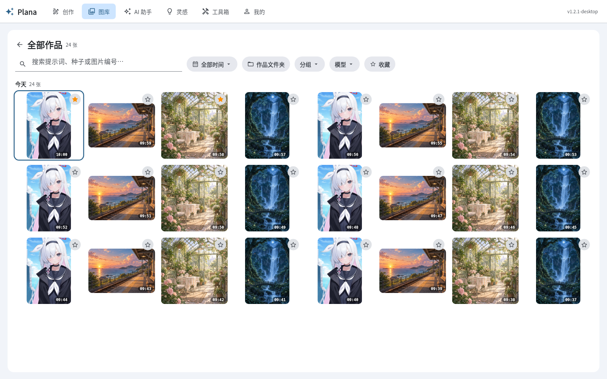

# Plana App Desktop

**面向 Windows 与 macOS 的开源 AI 桌面创作工作台**

在同一窗口内完成提示词编排、多画布出图、参考图控制、图库整理与 AI 助手协作。

[使用指南](#使用指南) · [下载与安装](#下载与安装) · [更新与数据](#更新与数据) · [注意事项](#注意事项) · [反馈与贡献](#反馈与贡献)

Plana App Desktop 将 [Plana App](https://github.com/mc5024/Plana-App) 带到桌面端，基于 [Windows 重构版](https://github.com/LingXia979/Plana-App-for-windows/tree/Plana-app-for-windows) 持续适配 Windows 与 macOS。

安装包**不附带**任何账号、点数或 API Key，生图需自行准备 NovelAI 令牌、兼容中转接口或 Bot 授权；AI 助手支持自定义接口或 ChatGPT 订阅授权。本项目采用 [GPL-3.0](LICENSE) 开源协议，是非官方第三方客户端，与 NovelAI（Anlatan）无关联。

## 使用指南

创作页采用三栏联动布局（左右两侧栏支持拖拽调宽与折叠收起），让你在同一窗口中同步编辑提示词、查看出图并与 AI 助手协作。

### 1. 快速上手（3 步出第一张图）

1. **配置接入**：打开「我的 → 账号与接入」。直连或中转用户在「管理令牌」中添加 NovelAI Token 或第三方接口 URL + Key 并设为主账号；Bot 用户在同页完成授权。两种路线可同时保留，并在顶部卡片按需切换。
2. **生成首图**：回到「创作」，选择模型（如 `NAI 5.0 Full`、`NAI 5.0 Full Medium` 或 `NAI 4.5 Full`），在正向提示词输入 `1girl, solo, white dress, blue sky, soft lighting`，确认分辨率后点击生成或按 `Ctrl+Enter` / `⌘Enter`。成图会显示在画布并自动写入当前图库与作品目录。
3. **迭代与整理**：直接把图片拖入窗口或粘贴用作图生图／Vibe／角色参考；在右侧栏唤醒 AI 助手润色提示词，或在「图库」中筛选、收藏和批量导出。

### 2. 创作工作台与提示词

- **多画布隔离与共享**：顶部支持创建并切换多张画布。每张画布独立保存提示词、角色卡、预设与采样参数；Vibe、角色参考、图生图、重绘与 LoRA 在画布之间共享，便于基于同一组参考图对比多套提示词方案。
- **提示词编排**：支持正负提示词分区、语义分块、标签／文本双视图切换、离线词库补全与预设切换；提示词卡片与角色卡支持折叠，也可打开大屏编辑器精修。
- **模型与并发调度**：覆盖 `NAI 5.0 Full`（1471 token）、`NAI 5.0 Full Medium`（节约 40% 额度）、`NAI 5.0 Curated`（703 token）及 `NAI 4.5` / `NAI 4.0` 系列。配置多组令牌后可多账号并发队列出图，并支持「循环生成」，顶栏任务面板实时显示运行状态。

### 3. 参考图、重绘与超分辨率

| 场景 | 入口与操作 | 说明与限制 |
|---|---|---|
| 图生图 / 局部重绘 | 拖入、剪贴板粘贴或从图库将图片「用作图生图底图」，调整强度（Strength）或绘制蒙版重绘 | 需使用支持图生图的 NAI 模型 |
| Vibe 与角色参考（Precise Reference） | 从文件、剪贴板或「角色参考图库」加入参考图 | **Vibe 与角色参考互斥**（开启一项会自动暂停另一项）；切换至 `NAI 5.0 Full Medium` 时角色参考会自动暂停 |
| 放大与超分辨率 | 在画布、图库或图片导入窗口执行「图生图放大」或 2×「超分辨率」 | 导入窗口可直接对外部图片读取元数据或执行超分 |

### 4. 右侧栏：AI 助手、灵感库与法典

宽屏创作页右侧提供 **助手 · 灵感 · 法典** 三个联动标签，不离开画布即可查阅资料或改词：

- **AI 助手**：在「接口与订阅」中配置 OpenAI / Anthropic / Gemini 兼容自定义接口、登录 ChatGPT 订阅授权，或使用 Bot 后端；支持多图附件、会话管理与消息编辑，并可直接输出提示词提案一键应用到当前画布（左侧主导航亦提供独立「AI」页面用于长对话）。
- **灵感库与法典**：管理自建与收藏词条，支持分类与多标签筛选、接入外部角色库（OC 源），并将角色、画风与场景一键导入创作页；法典页签便于随时检索画风与词条。

展开查看图库与 AI 助手界面截图

### 图库与作品管理

### AI 助手

### 5. 图库与作品整理

- 网格浏览全部作品，支持关键词搜索及按日期、模型、角色筛选；内置「收藏」与「回收站」（回收站按本地自然日保留 30 天，误删可恢复）。
- 支持多选批量操作（「添加到」「移动到」指定相册、批量导出 ZIP）。点击任意作品进入大图查看器，支持缩放、拖动、查看完整种子与提示词，以及一键复制图片。

### 6. 工具箱与数据备份

- **工具箱**（`我的 → 工具箱`，也可在「外观与体验」中开关显示在主导航栏）包含三个页签且切换时保留草稿：
  - `权重转换`：在 NAI 等权重语法之间快速转换（支持 `Ctrl+Enter` / `⌘Enter` 触发）。
  - `图片元数据`：读取、编辑与单张处理图片 PNG 信息，并可直接导入创作页参数。
  - `图片比对`：并排对比两张图片的画面与元数据差异。
- **备份与导入**（`我的 → 备份与导入`）：支持本地存档导入导出、Web 备份迁移、外部角色库管理，以及 Google Drive / 云端同步。

### 7. 快捷键与剪贴板路由

| 快捷键 | 生效位置 | 作用 |
|---|---|---|
| `Ctrl+Enter` / `⌘Enter` | 创作工作台 / 权重转换 | 立即触发生成 / 执行权重转换 |
| `Alt+A` / `Alt+I` | 创作工作台 | 切换并展开右侧「AI 助手」/「灵感」面板 |
| `Ctrl+V` / `⌘V` | 全局桌面窗口 | 粘贴图片时按鼠标所在接收区（画布导入、参考图、AI 助手）自动路由，区域外按焦点判断；普通文本照常粘贴 |
| `Ctrl+C` | 大图查看器 / 图库（非输入状态） | 复制当前图片到系统剪贴板（各界面亦提供复制按钮） |
| `←` / `→` | 大图查看器 / 图库 | 切换上一张 / 下一张图片 |
| `Esc` | 大图查看器 / 导入窗口 / 多选状态 | 关闭浮层或退出当前多选 |

## 下载与安装

当前公开预发布为 **1.2.5-desktop.1（构建 75）**。请前往 [发布页](https://github.com/shenghuo2/Plana-App-Desktop/releases/tag/v1.2.5-desktop.1) 下载（无需登录 GitHub；完整历史版本与更新日志见 [Releases](https://github.com/shenghuo2/Plana-App-Desktop/releases)）：

| 平台 | 安装包 | 选择建议 |
|---|---|---|
| Windows x64 | [安装程序 EXE](https://github.com/shenghuo2/Plana-App-Desktop/releases/download/v1.2.5-desktop.1/Plana-App-Desktop-Windows-1.2.5-desktop.1-x64-setup.exe) · [便携 ZIP](https://github.com/shenghuo2/Plana-App-Desktop/releases/download/v1.2.5-desktop.1/Plana-App-Desktop-Windows-1.2.5-desktop.1-x64.zip) | 安装版带中文向导与开始菜单入口；ZIP 适合便携使用 |
| macOS 14+ · Apple Silicon | [标准版 DMG](https://github.com/shenghuo2/Plana-App-Desktop/releases/download/v1.2.5-desktop.1/Plana-App-Desktop-macOS-arm64.dmg) | 日常绘图与本地作品管理 |

- **Windows**：运行 `-setup.exe` 按中文向导安装到可写目录（默认当前用户目录，无需管理员权限）；便携版解压 ZIP 后运行 `plana_app_for_windows.exe`，迁移时连同 `output` 目录一起移动。两种包均已内置所需运行库。
- **macOS**：退出旧版应用，打开 DMG 将 `Plana App Desktop.app` 拖入「应用程序」后启动。

发布页提供统一的 `SHA256SUMS.txt` 校验清单；多版本变体说明见 [DESKTOP-EDITIONS.md](DESKTOP-EDITIONS.md)。

## 更新与数据

点击顶栏版本号选择「检查更新」：自动检查带 24 小时缓存，手动检查立即拉取最新 Release。macOS 支持应用内下载、SHA-256 校验与替换重启；Windows 引导至发布页下载新包。详细校验机制见 [桌面更新说明](docs/desktop-updates.md)。

升级与改名沿用既有数据目录与加密凭据存储，账号、图库、历史与助手会话保持不变（详见 [名称与升级兼容](DESKTOP-EDITIONS.md#名称与升级兼容)）。自动保存的作品默认存放在：

| 平台 | 作品目录 |
|---|---|
| Windows | 程序目录中的 `output` 文件夹 |
| macOS | `~/Documents/Plana/output` |

## 注意事项

- **架构支持**：目前仅提供 Windows x64 与 macOS 14+ Apple Silicon（arm64）预编译包，暂不提供 macOS Intel 或 Linux 安装包。
- **代码签名**：Windows 安装包未做代码签名；macOS 安装包使用 ad-hoc 签名，尚未经过 Apple 公证，首次打开时可能需要手动在系统安全设置中放行。
- **平台特性差异**：内置「关于 → 使用手册」仅在具备 Microsoft Edge WebView2 运行时的 Windows 环境中可用。
- **本地诊断日志**：从 `1.2.1-desktop.1` 起本地保留最近 10 次启动的诊断日志（不自动上传、默认脱敏令牌），排查闪退时的收集方式见 [诊断记录说明](docs/diagnostics.md)。

## 反馈与贡献

- 提交 Issue 至 [本仓库 Issues](https://github.com/shenghuo2/Plana-App-Desktop/issues) 时，请附上系统与芯片架构、应用版本、复现步骤及脱敏后的诊断日志（见 [诊断记录说明](docs/diagnostics.md)），切勿泄露 API Key 或 Token。
- 参与源码开发、本地测试、CI 构建与提交规范，请阅读 [CONTRIBUTING.md](CONTRIBUTING.md)；双版本构建与发布分支策略见 [DESKTOP-EDITIONS.md](DESKTOP-EDITIONS.md)。

## 来源与许可

- 上游项目：[mc5024/Plana-App](https://github.com/mc5024/Plana-App)（原版与 Android 上游）、[LingXia979/Plana-App-for-windows](https://github.com/LingXia979/Plana-App-for-windows/tree/Plana-app-for-windows)（Windows 桌面重构）。
- 完整致谢与第三方数据／模型许可见 [致谢与数据来源](docs/ACKNOWLEDGEMENTS.md) 与 [第三方声明](THIRD_PARTY_NOTICES.md)。

Copyright (C) 2026 Sora_Light

本项目以 [GPL-3.0](LICENSE) 发布（分发修改版须遵守同一许可，本程序不作任何担保）。
